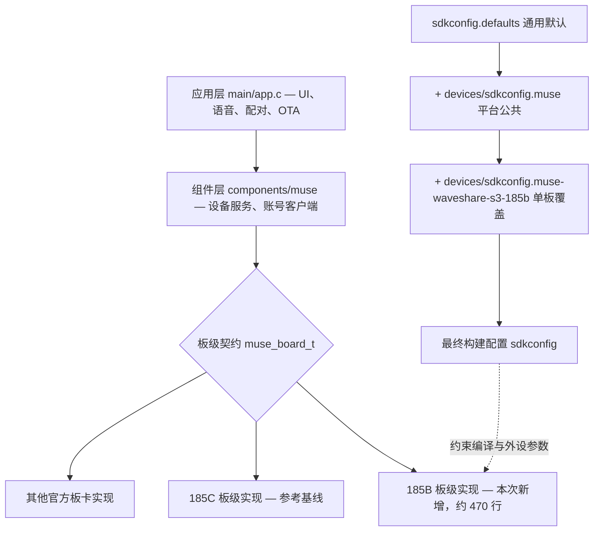
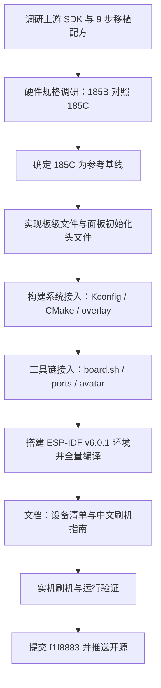

<!--
Copyright (c) Meta Platforms, Inc. and affiliates.

Licensed under the Apache License, Version 2.0 (the "License");
you may not use this file except in compliance with the License.
You may obtain a copy of the License at

    http://www.apache.org/licenses/LICENSE-2.0

Unless required by applicable law or agreed to in writing, software
distributed under the License is distributed on an "AS IS" BASIS,
WITHOUT WARRANTIES OR CONDITIONS OF ANY KIND, either express or implied.
See the License for the specific language governing permissions and
limitations under the License.
-->

# 从 Meta Muse Gadgets 到 Waveshare 1.85B：竞品分析与固件移植报告

> 本仓库是 [facebookincubator/muse-gadget-sdk](https://github.com/facebookincubator/muse-gadget-sdk) 的社区移植版（基线 `8e613f7`），新增 **Waveshare ESP32-S3-Touch-LCD-1.85B**（1.85" 360×360 圆形 LCD + CST816S 触摸）板卡支持。本 README 以产品视角完整复盘移植过程：平台竞品格局、硬件选型逻辑、移植技术原理、执行与验证数据。

> [!NOTE]
> **快速开始（需 ESP-IDF v6.0.1）**
>
> - 构建：`cd esp32 && tools/muse/board.sh build 185b`
> - 刷机与使用指导（中文）：[docs/WAVESHARE-1.85B-GUIDE.zh-CN.md](docs/WAVESHARE-1.85B-GUIDE.zh-CN.md)
> - 板卡支持清单：[esp32/devices/README.md](esp32/devices/README.md)
> - 配对前需在 [gadgets.muse.ai](https://gadgets.muse.ai/settings/sdk-tokens) 获取 SDK token（勿提交入库）

  <picture>
    <source media="(prefers-color-scheme: dark)" srcset=".github/images/muse-gadgets-dark.png">
    
  </picture>

Muse gadgets are open source devices you build yourself: program an
off-the-shelf ESP32 board or a Linux box with the device SDKs, and your Muse
agent gets a face, a voice and eyes. Built by hackers, for hackers, just for
fun — tinkering may include bricked boards and voided warranties. Proceed at
your own risk.

---

## 目录

1. [执行摘要](#1-执行摘要)
2. [市场与竞品格局分析](#2-市场与竞品格局分析)
3. [硬件选型与板卡竞品分析](#3-硬件选型与板卡竞品分析)
4. [移植方案与技术原理](#4-移植方案与技术原理)
5. [执行过程与问题管理](#5-执行过程与问题管理)
6. [验证结果](#6-验证结果)
7. [风险与局限](#7-风险与局限)
8. [建议与路线图](#8-建议与路线图)
9. [结论](#9-结论)

---

## 1 执行摘要

2026 年 10 月，Meta 将旗下 AI 智能体硬件平台 **Muse Gadgets** 开源，允许开发者把 Muse 云端智能体"装进"各类 ESP32 设备。本项目完成了将上游 SDK 移植到国产开发板 **Waveshare ESP32-S3-Touch-LCD-1.85B**（1.85 英寸圆形触屏）的全过程，产出可编译、可刷机、可运行的固件与完整中文文档，并开源至 GitHub。

从产品经理视角，本报告回答三个问题：**这个平台值不值得投入（竞品分析）**、**为什么选这块板子（选型分析）**、**移植是怎么做成的（原理与执行）**。

| 指标 | 数值 | 说明 |
|---|---|---|
| 文件 | 13 个 | 新增/修改代码与文档文件 |
| 代码 | +1170 行 | 净增量（commit `f1f8883`） |
| 构建 | 2196 目标 | ESP-IDF v6.0.1 全量编译通过 |
| 固件 | 2.02 MiB | 4 MiB OTA 分区余量约 48% |
| 板级差异 | 16 改动点 | 185C → 185B 收敛后的全部改动 |
| 刷机 | 4 分区 | 实机校验通过并进入配对广播态 |

> **核心结论**：上游 SDK 的板级抽象设计成熟，是本次移植能够低成本收敛的根本原因。新板卡与参考板 185C 的差异被隔离在单板级文件、单配置叠加层与三个工具脚本内，全部改动仅 16 个改动点、约 470 行板级代码，未触碰任何应用层逻辑。固件实机运行验证通过，设备进入 BLE 配对广播状态。
>
> **平台层面最大的产品风险不是技术，而是可用性**：Muse 服务当前仅对美国和加拿大开放，国内用户注册与使用需要美国出口 IP，且账号条款存在不确定性。相比之下，竞品"小智 AI"以 130 万台接入设备的生态规模和完全自主可控的部署方式占据国内市场。两者的差异决定了完全不同的目标用户与投入策略，详见第 2 章。

## 2 市场与竞品格局分析

### 2.1 赛道背景：AI 智能体从"App"走向"实体"

2026 年，AI 陪伴与智能体硬件形成了两条清晰的产品路线：**云端智能体 + 廉价终端**（厂商把算力放在云端虚拟机，硬件只负责拾音、显示与联网）和**端侧对话 + 开源生态**（开发者自选大模型、自建或使用厂商对话服务）。前者以 Meta Muse 为代表，后者以国产开源项目"小智 AI（xiaozhi-esp32）"为代表。两者都把 ESP32 这类几十元成本的微控制器作为终端载体，说明**"低成本硬件 + 云端智能"已成为行业共识**。

### 2.2 竞品对比：Muse Gadgets vs 小智 AI

| 维度 | Muse Gadgets（Meta） | 小智 AI（十方融海） |
|---|---|---|
| 定位 | 个人 AI 智能体的"硬件化身"：设备接入 Muse 云端 VM，智能体获得一张脸、一副嗓音和一双眼睛 | 开源 AI 语音聊天机器人框架：MCP 协议接大模型（Qwen、DeepSeek 等），语音对话与设备控制 |
| 开源协议 | Apache 2.0（SDK 与文档） | MIT |
| 智能体能力 | 云端常驻 VM、多模态、主动任务；与 Muse 账号体系（日程、消息）深度联动 | 依赖所接大模型；能力上限取决于模型与自建服务 |
| 生态规模 | 2026-10 开源，官方账号约 8.2 万关注，起步期 | GitHub 约 3 万星、7.1k fork；接入设备超 130 万台、开发者超 10 万 |
| 自主可控 | 强绑定 Meta 云端与账号，不支持私有部署 | 支持自建对话服务器，全链路可自主 |
| 区域可用性 | 仅美国、加拿大（18 岁以上），其他地区提示不可用；国内直连注册不通过 | 国内可正常注册使用 |
| 硬件支持 | 官方支持约 10 款板卡（ESP32-S3-Box-3、M5Stack 系列、Waveshare 185C 等），板级抽象规范 | 社区维护数十款开发板配置，覆盖面广但规范性参差 |
| 构建门槛 | 锁定 ESP-IDF v6.0.1 单一版本，配对需 SDK token，流程偏"产品化管控" | 提供 ESP-IDF 6 开发路径与多种烧录方式，社区文档丰富 |

**六维定性评分（1–5 分）**：

| 维度 | Muse Gadgets | 小智 AI |
|---|:---:|:---:|
| 生态规模 | 2 | 5 |
| 智能体能力深度 | 5 | 3 |
| 自主可控 | 1 | 5 |
| 区域可用性 | 1 | 5 |
| 商业与资源背书 | 5 | 3 |
| 硬件抽象成熟度 | 4 | 4 |

评分依据：竞品公开信息与本项目实测（区域可用性、自主可控两维为实测结论；其余为公开资料定性判断）。

### 2.3 竞争格局对产品决策的含义

两个平台并非零和竞争，而是**服务两类完全不同的用户**：Muse Gadgets 适合面向海外市场、追求"开箱即用的智能体体验"的产品团队——Meta 承担了最难的智能体与云基础设施；小智适合国内市场与强调数据自主的场景。本项目选择移植 Muse Gadgets 的价值在于**提前卡位海外生态的硬件适配层**：上游刚开源、板卡支持窗口期短，早期完成适配的社区仓库更容易获得关注与回流。

## 3 硬件选型与板卡竞品分析

### 3.1 候选板卡与关键规格

上游 SDK 官方支持的板卡中，与本项目目标形态（小圆形触屏桌面设备）最接近的是 Waveshare 1.85C。选型阶段对比了三块候选板卡：

| 规格项 | Waveshare 1.85B（目标板） | Waveshare 1.85C（参考基线） | ESP32-S3-Box-3 |
|---|---|---|---|
| SoC / Flash / PSRAM | ESP32-S3 / 16 MB / 8 MB 八线 | ESP32-S3 / 16 MB / 8 MB 八线 | ESP32-S3 / 16 MB / 16 MB |
| 屏幕 | 1.85" 圆形 360×360 ST77916 | 1.85" 圆形 360×360 ST77916 | 2.4" 方形 320×240 ILI9341 |
| 触摸 | CST816S，RST **直连 GPIO1** | CST816S，RST 经 **TCA9554** 扩展 | 电阻触摸 |
| 复位控制 | LCD RST **直连 GPIO3**，无 IO 扩展芯片 | LCD RST 经 TCA9554 I2C IO 扩展 | 直连 |
| 音频 | ES8311 功放（PA 使能 **GPIO9**）+ ES7210 麦克风 | ES8311 + ES7210，PA 控制 TCA9554 | ES8311 + ES7210 |
| 电池管理 | **BQ27220** 电量计（I2C @0x55） | 无独立电量计 | 无 |
| USB | Type-C，USB-Serial/JTAG 直刷 | Type-C，USB-Serial/JTAG | Type-C ×2 |
| 与目标差异面 | —（目标） | 复位架构 + 功放控制 + 电量计三处差异 | 屏幕形态、驱动、尺寸全面不同 |

### 3.2 选型逻辑：为什么以 185C 为参考基线

选型本质是**找"差异面最小"的官方支持板**。185C 与 185B 同厂、同屏、同 SoC、同音频链路，差异收敛在复位架构、功放控制与电量计三处，全部落在板级抽象层内；而 S3-Box-3 虽是官方旗舰参考板，但屏幕形态与驱动体系完全不同，移植工作量数倍于前者。实测也验证了这一点——最终板级差异仅 16 个改动点：

| 改动类别 | 数量 |
|---|:---:|
| 外设增删（删 TCA9554 / 增 BQ27220） | 2 |
| 复位引脚直连（LCD GPIO3 / 触摸 GPIO1） | 2 |
| 音频功放使能（GPIO9） | 1 |
| 构建系统（Kconfig / CMake / 组件规则 / 配置叠加） | 4 |
| 工具链（board.sh / ports.py / avatar.py） | 3 |
| 文档（设备清单 / 中文刷机指南 / README） | 4 |
| **合计** | **16** |

数据来源：commit `f1f8883` 的 13 个文件逐项归类统计。板级实现为核心工作量（约 470 行）。

## 4 移植方案与技术原理

### 4.1 上游架构：为什么"换一块板"可以很便宜

上游 SDK 用两套机制把"应用逻辑"与"板卡差异"彻底解耦。其一是**板级契约**：每块板用一个 C 文件实现统一的 `muse_board_t` 接口（屏幕点亮、背光、复位、音频、电量读取等），应用层只面向契约编程，不感知具体引脚。其二是**三层配置叠加**：通用默认值 → 平台公共配置 → 单板配置，逐层覆盖，新板只需提供最末一层：

左：调用链自上而下经板级契约分发；右：三层 sdkconfig 叠加生成最终配置。改动被限制在虚线框定的板级实现与最上层配置。

### 4.2 板级差异映射：185C 的三处差异如何转换

移植的技术核心，是把硬件差异翻译成契约内的等价实现。逐项原理如下：

| 差异项 | 185C 实现（基线） | 185B 实现原理（本次） |
|---|---|---|
| IO 扩展芯片 | TCA9554 I2C IO 扩展，复位脚挂在扩展芯片上 | 185B 无此芯片。**删除 TCA9554 驱动依赖**，LCD 复位改 **GPIO3 直控**、触摸复位改 **GPIO1 直控**——把"I2C 写扩展寄存器"翻译为"拉高拉低 GPIO"，时序更简单可靠 |
| 功放使能 | PA 使能经 TCA9554 | 改 **GPIO9 直控**；开机默认关断功放，避免上电爆音，音频会话开启时拉高 |
| 电池电量 | 无独立电量计，电量回退为电压估算或不支持 | 新增 **BQ27220 电量计驱动接入**（I2C 地址 0x55），直接读取精确电量百分比，契约接口无需改动 |
| 屏幕 / 触摸驱动 | ST77916 + CST816S，初始化序列内嵌在 185C 板级文件中 | 驱动**同源复用**，仅面板初始化序列随 185B 出厂校准微调，并**独立为 `st77916_init_185b.h` 头文件**，避免污染基线实现 |

屏幕（ST77916）与触摸（CST816S）、音频编解码（ES8311 + ES7210）两板同源，驱动完全复用；仅面板初始化序列参数随 185B 出厂校准微调，独立为头文件便于维护。

### 4.3 构建系统接入原理

新增一个板卡 ID 需要在四处"注册"：① Kconfig 增加板卡选择项（用户以 `MUSE_BOARD=` 选择）；② CMake 把板级源文件编入组件；③ 组件管理文件声明依赖（电量计、IO 扩展等）；④ 提供 72 行的板级配置叠加层（16 MB Flash、八线 PSRAM、双 LVGL 绘制单元等）。工具链侧，`board.sh` 注册 185b 构建档位，`ports.py` 与 `avatar.py` 注册串口探测规则与设备识别图案。全部改动不触碰上游任何应用代码，**保证了未来同步上游更新时的低冲突概率**。

## 5 执行过程与问题管理

### 5.1 总体流程

项目按"调研 → 基线 → 实现 → 验证 → 交付"五个阶段推进，关键路径为板级实现与编译验证：

流程与上游 AGENTS.md 移植配方对齐；S7 为唯一反复的阶段（环境问题），见 5.2。

### 5.2 问题日志：从产品复盘看执行风险

执行过程中记录了 6 个有代表性的问题。值得注意的是，**全部问题集中在"工程环境"而非"移植方案"**——板级方案一次通过，风险全部来自网络与 Windows 工具链，这对同类项目的资源评估有直接参考价值。

| # | 问题 | 影响 | 解决方式 |
|:---:|---|:---:|---|
| 1 | GitHub 直连大量连接重置，ESP-IDF 仓库与子模块克隆反复中断 | 阻塞 | 探测到本机 7890 代理端口，全部 git 操作改单命令级代理（不污染全局配置）；大子模块改 `blob:none` 部分克隆一次成功 |
| 2 | 中断的克隆留下损坏的子模块目录（esp_wifi/lib 只剩 .git） | 阻塞 | 删除残留目录与 .git/modules 对应项后重克隆 |
| 3 | 空远端 + 本地浅克隆导致首次 push 报对象缺失 | 阻塞 | `fetch --unshallow` 补全上游全量历史后推送成功 |
| 4 | 工具环境封禁 `cmd /c`，install.bat 常规方式不可用；PowerShell 下环境变量不跨命令持久 | 绕行 | 改用 PowerShell 直接调用 install.bat；构建时解析 `idf_tools.py export` 输出注入会话（正则需兼容行尾引号差异） |
| 5 | 刷机前重新编译时发现 riscv gdb 工具未安装成功，环境导出整体报错 | 绕行 | gdb 仅调试用、编译不需要；改为手动构造工具链 PATH 直接 ninja 增量构建通过（顺带修正 ccache 实际路径在二级子目录的问题） |
| 6 | 构建配置要求 SDK token，缺失时仅警告 | 预期 | 按设计处理：首次构建放行，用户提供 token 后写入构建目录 sdkconfig 重新编译（token 所在目录被 gitignore，已验证不入库） |

## 6 验证结果

### 6.1 编译验证

ESP-IDF v6.0.1 下 2196 个构建目标全部通过。关键配置项均按板级叠加层生效：`CONFIG_MUSE_BOARD_WAVESHARE_S3_185B`、16 MB Flash、八线 PSRAM、双 LVGL 绘制单元。固件体积 2.02 MiB，落在 4 MiB 的 ota_0 分区内，余量约 48%——**为后续功能迭代保留了整整一倍的余量**。分区采用双 OTA 槽（ota_0 / ota_1 各 4 MiB）加回滚机制，支持空中升级。

| 存储域 | 已用 / 已规划 | 空闲 / 未分配 | 合计 |
|---|:---:|:---:|:---:|
| OTA app 分区（单槽） | 2.02 MiB | 1.98 MiB | 4 MiB |
| 16 MB Flash 整机 | 8.13 MiB | 7.87 MiB | 16 MiB |

数据来源：`esp32/partitions_muse.csv` 分区表与构建输出。已规划分区含双 OTA 槽、NVS（Muse 设置与 BLE 绑定）、产测数据区。

### 6.2 实机刷机与运行验证

通过 Type-C 口（COM5，USB-Serial/JTAG）以 460800 波特率刷入四个分区（bootloader、分区表、OTA 数据、主程序），全部写入并哈希校验通过，复位后串口日志确认：

- **芯片识别**：ESP32-S3（QFN56）rev v0.2，双核 240 MHz，片上 PSRAM 8 MB 与配置一致；
- **系统运行**：心跳日志每 5 秒输出，PSRAM 占用约 4.8 MB，运行稳定；
- **业务状态**：设备进入 `ble=advertising` 配对广播态，符合预期（等待用户在 gadgets.muse.ai 输入屏幕配对码完成配对）；
- **凭据注入**：用户 SDK token 编译进固件后重新刷机，构建日志确认 token 生效、无缺失警告。

## 7 风险与局限

| 风险项 | 等级 | 类别 | 说明与应对 |
|---|:---:|:---:|---|
| Muse 服务区域限制 | 高 | 市场 | 仅美加开放，国内注册与配对需美国出口 IP；绕行使用违反服务条款，存在账号回收风险。SDK token 与账号绑定，账号失效即 token 失效。应对：面向国内用户的产品应评估小智等本土方案；Muse 适配定位为海外市场与技术研究 |
| 上游演进与版本锁定 | 中 | 技术 | SDK 锁定 ESP-IDF v6.0.1 单一版本，上游更新节奏快；需定期 rebase 并回归测试。本次改动全部隔离在板级层，冲突面已最小化 |
| 社区维护投入 | 中 | 运营 | 板卡支持需要持续响应 issue、适配上游变更；建议建立最小 CI（编译验证）降低维护成本 |
| 音频与功耗未深度调优 | 低 | 技术 | ES8311/ES7210 驱动复用基线参数，BQ27220 已接入但功耗策略未针对电池场景优化，属后续迭代项 |

## 8 建议与路线图

- **短期（1–2 周）：把"能用"变成"好用"** — 补充分辨率/触摸的实机体验校准；录制端到端配对演示视频；在 README 增加常见问题（区域限制、token 管理、驱动安装）。
- **中期（1–2 月）：融入上游生态** — 向上游提交 185B 支持的 PR，争取进入官方板卡清单；建立 GitHub Actions 编译验证；补充 BQ27220 电量显示与低电策略的产品化打磨。
- **长期（季度级）：横向扩展与差异化** — 以同一板级契约模式扩展更多国产圆形屏板卡形成"板卡矩阵"；评估基于 Muse VM 的自定义表盘/技能；同时保持对小智生态的对标观察，双平台能力可复用同一硬件抽象经验。

## 9 结论

本次移植以 **16 个改动点、约 470 行板级代码**的边际成本，让一款国产圆形触屏开发板接入 Meta 的 AI 智能体生态，编译、刷机、运行三级验证全部通过并开源交付。它验证了上游 SDK 板级抽象的设计价值：**好的架构能把"适配一块新硬件"收敛成一次低风险的局部手术**。

从竞争格局看，Muse Gadgets 的智能体能力与工程规范性是显著优势，但区域可用性与账号绑定构成国内市场的硬约束；小智 AI 以开放生态与规模占据本土场景。对产品团队而言，**两条路线的板级适配经验高度可迁移**——本项目沉淀的硬件抽象方法论与踩坑记录，同样适用于任何"云端智能体 + 廉价终端"形态的产品孵化。

---

## 参考来源

1. [facebookincubator/muse-gadget-sdk — 上游 SDK 仓库，含 AGENTS.md 移植配方与板级契约定义](https://github.com/facebookincubator/muse-gadget-sdk)
2. [timemeetme/muse-gadgets-waveshare-ESP32-S3-Touch-LCD-1.85B — 本项目交付仓库（commit f1f8883）](https://github.com/timemeetme/muse-gadgets-waveshare-ESP32-S3-Touch-LCD-1.85B)
3. [Zentor Blog, Meta Muse Availability: US Only, For Now — Muse 2026-09-08 美国首发信息](https://zentor.ai/blog/meta-muse-availability)
4. [UseCarly, Where Is Meta Muse Available? — 美加两国开放、其余地区不可用的提示原文](https://www.usecarly.com/blog/meta-muse-availability/)
5. [51CTO，Meta Muse 上手教程 — 国内直连注册不通过的现象与绕行方式](https://www.51cto.com/article/857341.html)
6. [搜狐科技，Muse 大更新：Muse Gadgets — 开源发布与官方账号 8.2 万关注者](https://news.sohu.com/a/1083755683_122105141)
7. [羊城晚报，十方融海"小智 AI"开源框架 — 26000+ 星、接入设备超 130 万台、开发者超 10 万](http://news.ycwb.com/ikimvkotil/content_54087899.htm)
8. [XiaoZhi AI 官网 — MIT 协议、MCP 协议、Qwen/DeepSeek 模型、多芯片平台支持](https://xiaozhi.me/home/en/)
9. [VibeCrowd, 78/xiaozhi-esp32 — 30,332 stars / 7.1k forks 实时数据（2026-10）](https://vibecrowd.ai/repos/78--xiaozhi-esp32)
10. [腾讯新闻，Meta 开源 Muse Gadgets — ESP32 固件与 Linux SDK 双路径、token 获取流程](http://news.qq.com/rain/a/20261003A09SDK00)

## Community

Meet other hackers who are building and customizing Muse gadgets in our
community [Discord](https://discord.gg/3bhjCkZdd6). Get inspired, support each
other, and share what you make.

## License

Muse Gadgets is licensed under the Apache License, Version 2.0, found in
[`LICENSE`](LICENSE), except for these third-party files, which keep their
upstream licenses:

| Path | Upstream | License |
|---|---|---|
| [`esp32/components/minimp3/include/minimp3.h`](esp32/components/minimp3) | [lieff/minimp3](https://github.com/lieff/minimp3) | CC0-1.0, see [`LICENSE`](esp32/components/minimp3/LICENSE) |
| [`esp32/components/muse/boards/ostb_echoear_display_init.h`](esp32/components/muse/boards/ostb_echoear_display_init.h) | [78/xiaozhi-esp32 ESP-VoCat panel sequence](https://github.com/78/xiaozhi-esp32/blob/0d576d3d4c049c6f55eaf879725dc23e516511b4/main/boards/espressif/esp-vocat/esp_vocat.cc) | MIT, retained in the file header |
| [`esp32/main/pixel_font.c`](esp32/main/pixel_font.c) | Adafruit GFX `glcdfont.c` | BSD-2-Clause, in the file header |

Dependencies fetched at build time are under their own licenses: ESP-IDF
components (into `esp32/managed_components/`), and the simulator's LVGL and
SDL (listed in [`esp32/simulator/THIRD_PARTY.md`](esp32/simulator/THIRD_PARTY.md)).

The Apache License does not cover the [Jollybot avatar](esp32/avatar).
